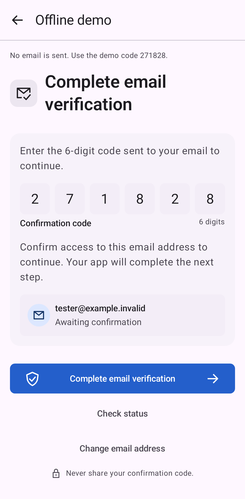
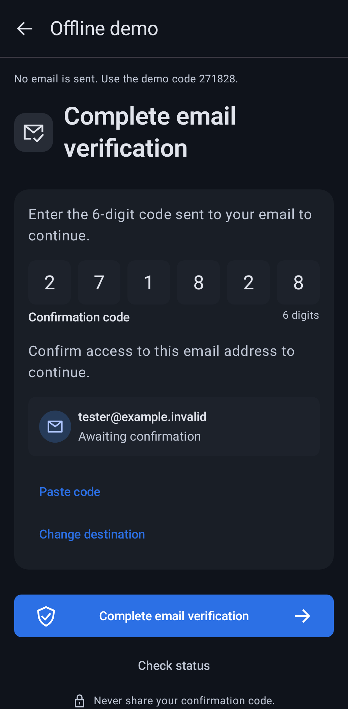

# ApexFission Email Verification

A reusable Android Compose email-verification widget and a standalone app for development and demos. Its launcher catalog offers an offline flow and a separate connection to an isolated Go email-verification test host. **App settings** at the top opens Android's settings for this installed demo.

Normal builds retain the published **UI Common 0.1.1** JitPack artifact. The updated action row and
error treatment are validated in CI against a pinned UI Common source checkout, pending its next
release. See the [integration instructions](docs/agents/android.md#ui-common-dependency).

| Manual code, light | Manual code, dark |
| --- | --- |
|  |  |

Synthetic Compose previews from the runnable demo; [capture provenance](docs/screenshots/manual-code.json).

| Component | Use |
| --- | --- |
| `:email-verification` | Embed the email and six-digit code flow in a Material 3 host. Connect the Go test host or provide a custom `VerificationGateway`. |
| `:app` | Choose **Open offline demo** and use code `271828`, or **Connect to test host** for live verification. Consumes the local library with a shared UI Common catalog. |
| `testhost` | Import the Go HTTP client in integration tests and tooling that need to exercise the same test host. |

Open this repo in Android Studio with JDK 17 or newer and Android SDK 37.0. Run the `app` configuration on an API 28+ device or emulator. From a terminal, use `./gradlew :app:installDebug`. Use `go test ./...` for the Go client.

See the [integration guides](docs/agents/index.md), [live test-host setup](docs/agents/demo.md), and [screenshot review workflow](docs/agents/screenshots.md). The Android module is available from source in development.

The email-entry and code-confirmation flow was adapted from [ApexFission Auth](https://github.com/lambdawalker/android.apexfission.auth/tree/659d208fd933cea97bb448b8581bfc6532b57be4/auth/src/main/java/com/apexfission/android/auth/ui/onboarding/email), which licenses it under Apache 2.0. Code entry and paste use [ApexFission UI Common](https://github.com/lambdawalker/android.ui.common).
