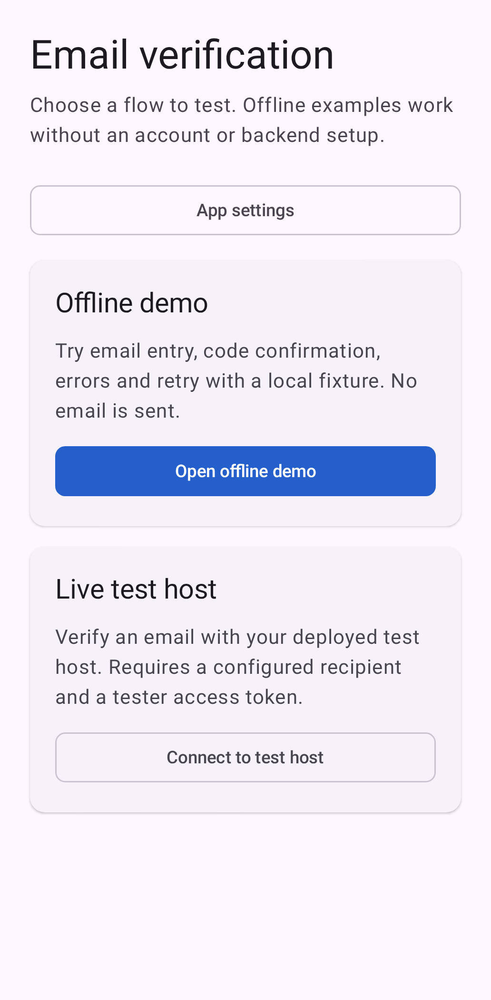
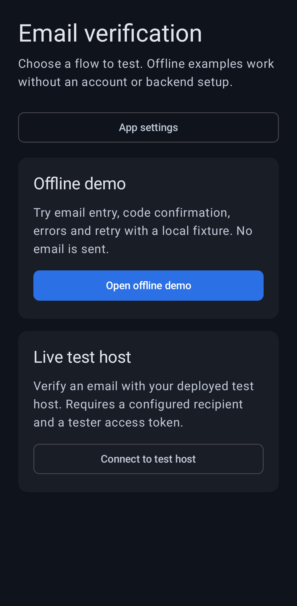
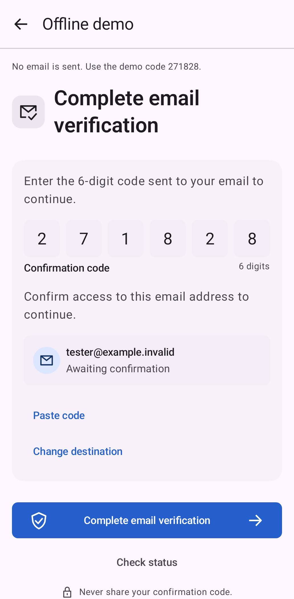
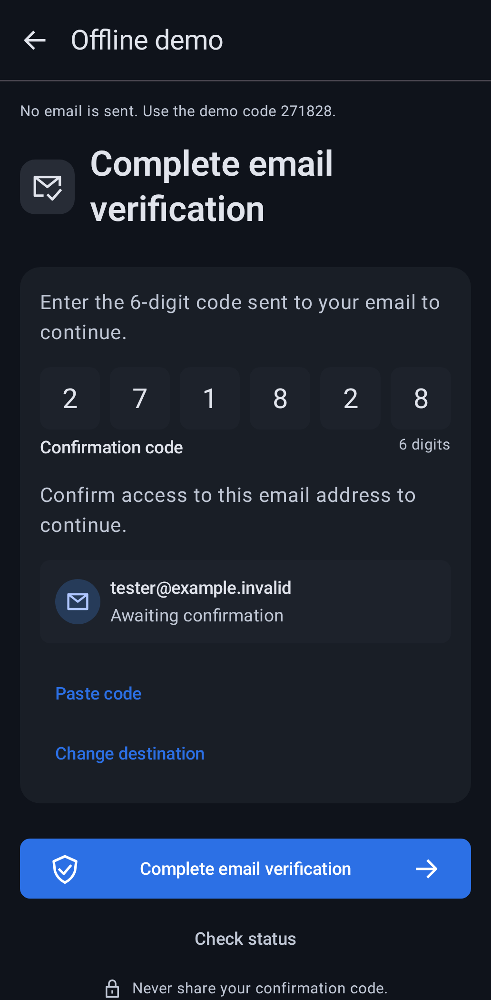

# Run the demo

## Launcher and App settings

The current Development branch needs the [UI Common source override](android.md#pending-ui-common-release)
until its new card API is published. Add `-PuiCommonSourceDir=/absolute/path/to/android.ui.common`
to the Gradle commands below for this staged integration.

Build with `./gradlew :app:assembleDebug`, install with `./gradlew :app:installDebug`, then open **Email Verification Demo**. The explicit launch command is `adb shell am start -n com.apexfission.android.emailverification.demo/.MainActivity`. The app requires API 28+ and the repository's Android toolchain. Its `:app` module consumes `project(":email-verification")`; the demo is not a published library artifact.

The launcher uses UI Common's `CatalogScreen`, `ContentCard` and `SectionHeading`, with **App settings** above the Offline and Live entries. It opens `Settings.ACTION_APPLICATION_DETAILS_SETTINGS` with the installed package's `package:` URI, so it also works when an application-ID suffix is used. System Back returns to the catalog. This component needs no runtime permissions; there is no permission cache or permission request to refresh. Launching the catalog and using the offline example make no network requests.

| Entry | Actions and expected result | Recovery and source |
| --- | --- | --- |
| App settings | Open Android's application-details page for this demo; use system Back to return. | The catalog remains usable; [Activity wiring](../../app/src/main/java/com/apexfission/android/emailverification/demo/MainActivity.kt). |
| Open offline demo | Send the synthetic address, try an incorrect code, then `271828`; the local fixture completes without email or backend verification. | Retry, **Start over**, or **Back to demo menu**; [catalog and flow shell](../../app/src/main/java/com/apexfission/android/emailverification/demo/DemoScreens.kt). |
| Connect to test host | Discover an environment or enter its URL, provide a tester access token, then exercise the real widget with the configured recipient. | Discovery failure leaves manual input and refresh available; system Back or **Back to demo menu** cancels and discards the session; [connection form](../../app/src/main/java/com/apexfission/android/emailverification/demo/LiveConnectionScreen.kt). |

The host owns navigation, environment discovery and in-memory demo sessions. Returning to the menu cancels pending work and replaces the live gateway, discarding its token, proof and recipient. Activity recreation retains the selected flow through its ViewModel. Process death returns to the catalog and requires a new live session; credentials are not saved. See [session ownership](../../app/src/main/java/com/apexfission/android/emailverification/demo/DemoModel.kt). App labels are available in English and Spanish; the library widget currently uses its existing English resources.

## Catalog preview

| Light | Dark |
| --- | --- |
|  |  |

These reviewed Compose-rendered previews show the production catalog at 393 × 800 dp. [Capture provenance](../screenshots/demo-catalog.json) records the source commit and PNG hashes. They document the layout; the device tests separately verify navigation and the Android Settings round trip. Regression baseline acceptance remains part of the [screenshot review workflow](screenshots.md).

## Offline

| Manual code, light | Manual code, dark |
| --- | --- |
|  |  |

These synthetic previews show a complete local example code before submission. The recipient stays
**Awaiting confirmation** until the controller advances. The blue/slate palette belongs to the demo;
the reusable widget inherits its host theme. **Paste code** and **Change destination** sit below
the recipient card. Tapping a digit selects it, and the highlight follows typing. [Capture provenance](../screenshots/manual-code.json).

Choose **Open offline demo**, leave the sample address in place, tap **Send code**, then enter `271828`. Enter a different six-digit code first to see the error and retry state. Offline mode uses an in-memory fixture and sends no email. **Start over** starts another attempt; **Back to demo menu** and system Back leave the flow.

## Live

Choosing **Connect to test host** loads the public directory at
`https://index.components.email-verification.apexfission.com/v1/environments`.
Choose an environment to fill in its API URL and show its Cognito public client
settings. If discovery is unavailable or a custom host is in use, enter the
API URL manually. The access token is used only for the test host.

1. Deploy the [Go email-verification test host](https://github.com/lambdawalker/go.apexfission.aws.email-verification/blob/main/docs/design/test-host.md) with a mobile hostname. Use the deployed `testHostMobileURL` for the chosen environment. The suggested development hostname is `https://dev.components.email-verification.apexfission.com`.
2. Verify the SES sender and configure the single permitted test recipient. If SES is in its sandbox, verify the recipient in SES too. Invite a tester in the environment's Cognito pool and complete any first-login challenge in an SRP-capable client using `testHostMobileUserPoolID` and `testHostMobileClientID`.
3. Sign in to the same pool and app client via SRP and obtain the session's Cognito **access token**. For example, an existing Amplify client can retrieve it with `(await fetchAuthSession()).tokens?.accessToken?.toString()` in JavaScript. In the demo, choose **Connect to test host**, enter the selected URL and paste the access token. The app keeps it in memory. Clear any clipboard copy after pasting.
4. Send to the configured test recipient and enter the code you received. The result may take a worker cycle to settle. Use **Check status** if automatic polling ends before the host accepts it.

The demo consumes a developer-supplied session. Use a fresh access token if authorization expires. Return to the menu before choosing another demo; this discards the live session and its proof. A 401 or 403 can indicate an expired token or a pool or app client mismatch. A code request rejected on submit can indicate that the address differs from the configured recipient. For the deployment and mail settings, see the test-host runbook above.

## Verify the host

Run `./gradlew :app:testDebugUnitTest :email-verification:testDebugUnitTest :email-verification:lintDebug :app:lintDebug :app:assembleDebug :app:assembleDebugAndroidTest` for host/library tests, lint and APK compilation. Run `./gradlew :app:connectedDebugAndroidTest` with a connected device/emulator for the settings intent, actual Android Settings round trip, offline navigation/back behavior and activity recreation. CI runs these device checks on an API 35 emulator. Unit tests inject the directory loader to verify cancellation and recovery without contacting a backend. Device tests use the offline demo and do not send email.

The [screenshot suite](screenshots.md) renders the same visual screens with inert callbacks. It validates layout coverage, not system-settings behavior or live delivery. Live verification still needs the configured deployment, invited tester and recipient described above.
