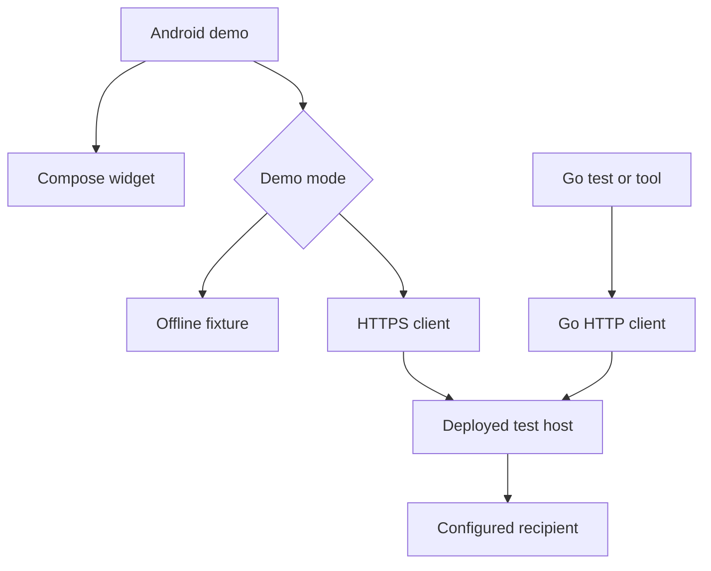

# Email verification

Embed the widget in an Android screen or use the demo to test email entry and six-digit confirmation against a standalone Go deployment. The Go package is an HTTP client for that deployment. Composed Go apps can use the [backend feature library](https://github.com/lambdawalker/go.apexfission.aws.email-verification) directly.

| Guide | Purpose |
| --- | --- |
| [Integrate on Android](android.md) | Library dependency, host theme, state and navigation. |
| [Run the demo](demo.md) | Offline steps, live service, tester credentials and troubleshooting. |
| [Integrate from Go](go.md) | Package import, proof lifetime, test-host calls and result handling. |
| [Review screenshots](screenshots.md) | Scenario coverage and baseline acceptance. |
